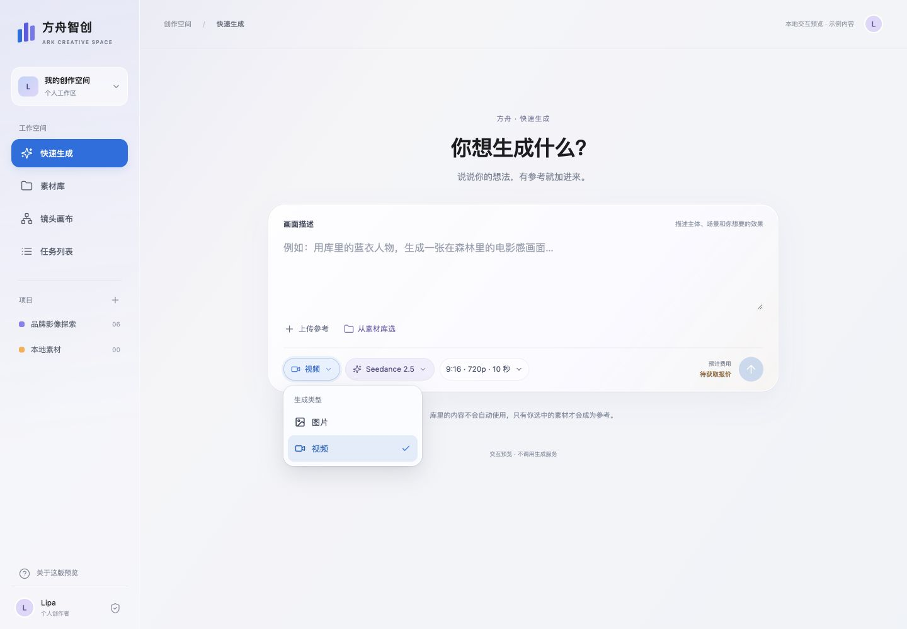

# 方舟 UI / VI 成果总入口

2026-10-19 已同步本轮完整设计成果，保持此仓库私有。外部首页选定 **08**，主标题 **用 AI，想象内容的下一种可能**，沿用黄色服装主视觉、透明Logo和Apple系统字体。

| 内容 | 入口 |
|---|---|
| 已选08首页源码与预览 | [design/fangzhou-reference-10](design/fangzhou-reference-10/README.md) |
| 已选首页截图 | [08中文Slogan](design/fangzhou-reference-10/screens/editorial-30/selected-08-slogan-zh.png) |
| 内部卡片三种风格 | [风格说明](design/fangzhou-reference-10/INTERNAL-CARD-STYLES.md) · [A](design/fangzhou-reference-10/screens/internal-cards/A.png) / [B](design/fangzhou-reference-10/screens/internal-cards/B.png) / [C](design/fangzhou-reference-10/screens/internal-cards/C.png) |
| Logo与品牌原型 | [design/fangzhou-brand-preview](design/fangzhou-brand-preview/README.md) |
| VI文字、变量与13状态 | [design/fangzhou-vi-v1](design/fangzhou-vi-v1/README.md) |
| 选择与修改记录 | [EDITORIAL-30-NOTES](design/fangzhou-reference-10/EDITORIAL-30-NOTES.md) |
| 文件清单与SHA256 | [SYNC-MANIFEST.json](SYNC-MANIFEST.json) |

## 运行

在仓库根目录执行 `python3 -m http.server 8783 --bind 127.0.0.1`，打开 `http://127.0.0.1:8783/START-HERE.html`。

要重新构建最新探索页面：`cd design/fangzhou-reference-10 && npm ci && npm run build`。本轮保留根目录原有内部原型及其历史，新增成果按目录归档，不覆盖旧功能。

本次包含三个方舟UI/VI成果目录中的页面、源码、必要资产、截图、参考来源与许可证；排除依赖安装目录、系统文件、缓存、凭据、生成源映射与无关业务资料。全部文件是私有研究/原型交付；账号、生成、计费、生产权限并未接入。GitHub同步不等于网站公网部署。内卡A/B/C待用户选择，外部首页08已选定。

---

## 早期内部原型记录

# 方舟智创 · UI 交互预览

基于 Lipa UI 的方舟创作工具改版原型。当前版将个人生成入口收敛为一个输入框，保留描述、模型、参考素材、输出规格与费用位置；修正了原生下拉菜单与界面视觉不一致的问题。

这是独立的前端评审原型，尚未连接方舟生产接口，不调用生成服务或扣费。

## 本地运行

需要 Node.js 和 npm；静态预览命令使用 Python 3。

```sh
npm ci
npm run build
python3 -m http.server 8774 --bind 127.0.0.1
```

浏览器打开 http://127.0.0.1:8774/ 。仓库同时保留已构建的 `app.js` 和 `app.css`，可以直接静态预览。

## 当前交互

- 快速生成：描述、图片/视频、模型、输出摘要、参考上传/选择与费用集中；图片/视频分别保留当前页面会话内的模型和规格。
- 选择控件：生成类型、模型、参考用途和画布参数使用统一的 Radix Select；输出参数通过 Radix Popover 中的选项按钮修改。
- 素材库：示例作品浏览、选择、预览、引用到生成区、加入画布。
- 镜头画布：React Flow 节点拖动、缩放、连线与上下文工具。
- 任务列表：本地演示任务记录模型与输出规格，支持个人/管理员演示视角。演示切换不代表真实权限。

## VI

蓝色 `#0071E3` 用于主操作，紫色 `#5E5CE6` 用于模型和引用，橙色 `#FF9500` 用于费用提示。银白内容区与有限的半透明浮层；菜单展开态与触发控件统一设计。

## 最新展开态



更多截图：[模型](menu-model-desktop.png) · [输出规格](menu-output-desktop.png) · [手机模型](menu-model-mobile.png) · [手机输出规格](menu-output-mobile.png)

## 实现与来源

- [源码与素材来源](SOURCE-NOTES.md)：BeatDesign 实际移植组件、Onlook 布局参考、Media Studio 仅结构参考；BeatDesign 的 Apache-2.0 许可证位于 `licenses/`。
- [即梦对照与方舟字段核验](jimeng-composer-review.md)：观察与方案推导、模型命名来源及服务边界。
- 菜单基础：[Radix Select](https://www.radix-ui.com/primitives/docs/components/select) / [Radix Popover](https://www.radix-ui.com/primitives/docs/components/popover)。
- 原始选向记录：[SELECTION.md](SELECTION.md)。选择参考方向不等于用户认可最终视觉。

## 验证与限制

构建通过。已在浏览器检查桌面 1440px 与手机 390px 的相关菜单展开状态；检查方向键选择、Enter 确认、Escape 关闭并回焦；检查输出摘要更新及模型/参数切换保留。

本地任务仅保留在本次页面会话，刷新清空；上传文件只建立浏览器对象 URL，不发送服务器。报价显示“待获取报价”。模型名称是从方舟原站菜单观察到的子集，代码 ID 为原型内部键，不能直接作为生产 API 标识；正式接入需按服务端能力表约束规格。

尚未实现真实生成、计费、管理员鉴权或剪辑服务；未完成大规模画布性能验证。示例素材不代表方舟生成结果，正式上线前需核验素材权利并替换为产品自有素材。

旧版代码与旧截图留在本地 `revisions/` 和输出目录，不纳入本次同步。
